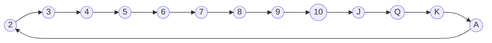

<!-- GENERATED by scripts/gen-docs.js - do not edit by hand. Run `npm run docs:gen`. -->

# Game constants

Generated from the game engine, so the numbers here are exactly the ones the
server plays with.

## The deck

<button type="button" data-pd-shuffle>Shuffle (Fisher-Yates)</button> <button type="button" data-pd-sort>Fresh deck</button> 110 cards, as `createDeck()` builds them

2♥3♥4♥5♥6♥7♥8♥9♥10♥J♥Q♥K♥A♥2♦3♦4♦5♦6♦7♦8♦9♦10♦J♦Q♦K♦A♦2♣3♣4♣5♣6♣7♣8♣9♣10♣J♣Q♣K♣A♣2♠3♠4♠5♠6♠7♠8♠9♠10♠J♠Q♠K♠A♠2♥3♥4♥5♥6♥7♥8♥9♥10♥J♥Q♥K♥A♥2♦3♦4♦5♦6♦7♦8♦9♦10♦J♦Q♦K♦A♦2♣3♣4♣5♣6♣7♣8♣9♣10♣J♣Q♣K♣A♣2♠3♠4♠5♠6♠7♠8♠9♠10♠J♠Q♠K♠A♠JK★JK★JK★JK★JK★JK★

Two standard decks plus jokers. The shuffle button runs the same algorithm as
`game/Deck.js` - unbiased, every order equally likely - which is the whole
answer to "is the shuffle fair?" in the {doc}`../faq`.

| | |
| --- | --- |
| Cards in play | **110** (2 standard decks + jokers) |
| Jokers | **6** |
| Cards dealt per player | **15** |
| Players | **2 - 4** |

## Card values

| Card | | Points |
| --- | --- | --- |
| Queen of Spades (Pik Dame) | Q♠ | **100** |
| Joker | JK★ | **20** |
| Ace | A♥ | **20** |
| 10, Jack, Queen, King | 10♣ J♣ Q♣ K♣ | **10** |
| 2 - 9 | 2♦ 9♦ | **5** |

## Combinations

| | |
| --- | --- |
| Set (same rank) | 3 - **8** cards, each suit at most **2×** (two decks) |
| Run (same suit) | 3 - **13** cards, circular: `K-A-2` is valid, no rank twice |

Runs live on a ring: after the king comes the ace, after the ace the two. A
run may start anywhere on it and use at most every rank once.

## Scoring

| | |
| --- | --- |
| Game ends at | **1000** points |
| `handAusDoubles` (default) | `false` - going out in one turn doubles the round score |
| `strictThreshold` (default) | `false` - if true the game ends only *above* 1000, not *at* it |

The winner of a round scores only their melds. Everyone else scores
*melds minus the cards left in hand* - so a Queen of Spades caught in hand costs
**100** points.
