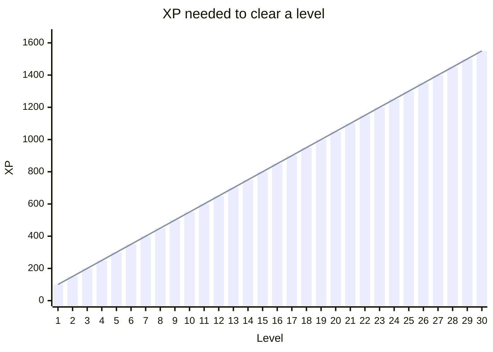

<!-- GENERATED by scripts/gen-docs.js - do not edit by hand. Run `npm run docs:gen`. -->

# Progression

Generated from `game/Progression.js`, `game/Badges.js`, `game/Emotes.js`
and `game/BotQuips.js`; the display names come from the client's own
bilingual tables. Ids are stable, names may change.

## Experience

| Event | XP |
| --- | --- |
| Finishing a match (won or lost) | **10** |
| Winning it | **+50** |
| Final score | **+1 per 10 points** (never negative) |

Each level costs a little more than the last, so the first levels arrive
after an evening of play and the later ones stay meaningful:

| Level | XP for this level | Total XP to reach it |
| --- | --- | --- |
| 1 | 100 | 0 |
| 2 | 150 | 100 |
| 3 | 200 | 250 |
| 5 | 300 | 700 |
| 10 | 550 | 2700 |
| 20 | 1050 | 10450 |
| 50 | 2550 | 63700 |

Seasons are calendar months; the ladder resets so late starters have
something reachable.

## Daily quests

**3** of these per game day, the same three for everyone
(seeded from the date, like the challenge deck):

| Id | Task | Count |
| --- | --- | --- |
| `finish_game` | Finish one match | 1 |
| `win_game` | Win a match | 1 |
| `win_rounds_3` | Win 3 rounds | 3 |
| `meld_queen` | Meld a Queen of Spades | 1 |
| `meld_jokers_3` | Meld 3 jokers | 3 |
| `round_150` | Score 150+ in one round | 1 |
| `clean_hands` | Finish a match never caught with the Queen | 1 |
| `hand_aus` | Win a round with "out in one" | 1 |
| `score_400` | Finish a match with 400+ points | 1 |
| `beat_zen` | Beat a table with a zen bot | 1 |

A daily streak survives one missed day every 7 days
(the "joker day"); after 7 days away the app says welcome
back instead of showing a broken streak.

## Badges

**48** badges. 9 of them are *families*: one tile, rising
thresholds on the same counter.

| Family | Counter | Tiers |
| --- | --- | --- |
| `queens` | `totalQueensLaid` | ♠ Queen collector {bdg-secondary}`1` → 🎯 Queen hunter {bdg-secondary}`10` → 🎯 Queen legend {bdg-secondary}`50` |
| `games` | `gamesPlayed` | 🏃 Marathon {bdg-secondary}`10` → 🏃 Long runner {bdg-secondary}`50` → 🏃 Staying power {bdg-secondary}`100` |
| `wins` | `gamesWon` | 🏆 First win {bdg-secondary}`1` → 🏆 Serial winner {bdg-secondary}`10` → 🏆 Table legend {bdg-secondary}`50` |
| `streak` | `winStreak` | 🔥 Winning streak {bdg-secondary}`3` → 🔥 Wildfire {bdg-secondary}`5` → 🔥 Unstoppable {bdg-secondary}`10` |
| `handaus` | `totalHandAus` | 🚀 Out in one! {bdg-secondary}`1` → 🚀 Lightning hand {bdg-secondary}`5` |
| `daily` | `dailyStreak` | 📅 A week running {bdg-secondary}`7` → 🗓️ A month running {bdg-secondary}`30` |
| `hearts` | `gamesLost` | 💜 Brave heart {bdg-secondary}`10` → 💜 Unbreakable {bdg-secondary}`50` → 💜 Heart of gold {bdg-secondary}`100` |
| `challenger` | `totalChallenges` | 🏁 Challenger {bdg-secondary}`7` → 🏁 Challenge pro {bdg-secondary}`30` |
| `puzzles` | `totalPuzzlesSolved` | 🧩 Puzzle fox {bdg-secondary}`7` → 🧩 Puzzle master {bdg-secondary}`30` |

The other **25** are earned by a fact about one match (computed in
`computeEarnedBadges` from the finished game record):

| | Badge | Earned by | Id |
| --- | --- | --- | --- |
| 🎩 | **Hat trick** | Melded 3+ Queens of Spades in one game | `pd_triple` |
| 😱 | **Ouch!** | Caught with the Queen of Spades in hand (−100) | `pd_caught` |
| 💯 | **Point royalty** | Finished a game with 500+ points | `score_500` |
| 🐢 | **Comeback** | Last after round 1 - and still won | `comeback` |
| 👯 | **Double queen** | Melded BOTH Queens of Spades in the same round | `double_queen_round` |
| 💥 | **Monster round** | 300+ points in a single round | `round_300` |
| ⚔️ | **Zen slayer** | Won a game with a zen master at the table | `zen_slayer` |
| 🔄 | **Full circle** | Melded a run wrapping K-A-2 | `ring_run` |
| 🌈 | **The whole suit** | Melded a full 13-card run | `run_13` |
| 🍽️ | **Pile glutton** | Picked up 10+ discards and still won the round | `pile_glutton` |
| 🧘 | **Three masters** | Beat three zen masters | `zen_trio` |
| 🃏 | **No jokers** | Won a game without ever melding a joker | `no_joker_win` |
| 😤 | **Red lantern** | Last place in 3 games in a row | `red_lantern` |
| 😡 | **Rock bottom** | Finished a game below zero | `rock_bottom` |
| 🥶 | **Cold shower** | Caught with both Queens of Spades in one round (−200) | `cold_shower` |
| 🤹 | **Joker king** | Melded 4+ jokers in one round | `joker_king` |
| ⚡ | **Lightning start** | Out in one in round 1 | `quick_start` |
| 😅 | **So close** | Lost by less than 20 points | `near_miss` |
| 🏔️ | **Landslide** | Won by 500+ points | `landslide` |
| 🦉 | **Night owl** | Finished a game between midnight and 4 am | `night_owl` |
| 🍻 | **Table regular** | 10 games at a regulars table | `stammtisch_10` |
| 🥇 | **Champion of the day** | First place in a daily challenge | `challenge_champ` |
| 🧲 | **Queen magnet of the day** | Daily challenge: caught with the Queen of Spades the most | `queen_magnet_day` |
| 💎 | **Royal flush** | Melded 10-J-Q-K-A of one suit, no jokers | `royal_flush` |
| 👑 | **Spade royal** | Royal flush in spades - with the Queen of Spades | `pik_royal` |

## Table talk

Reactions are a whitelist on the server (a safety filter) and unlock by level
on the client:

| Emote | Unlocked |
| --- | --- |
| 👍 | always |
| 😂 | always |
| 😱 | always |
| 😤 | always |
| 🎉 | always |
| ⏳ | always |
| ♠Q (mini card) | always |
| 👏 | level 2 |
| 🙈 | level 3 |
| 🤔 | level 4 |
| 🍀 | level 5 |
| 😎 | level 6 |
| 🔥 | level 8 |
| 😴 | level 10 |
| 🙏 | level 12 |
| 🤩 | level 14 |
| 🥳 | level 16 |
| 💪 | level 18 |

Seasonal extras the client offers in autumn and around New Year: 🎃 🎆
(always accepted server-side). On their holiday everyone also gets 🎅 🎄 🐣
(`game/Holidays.js`). On a configured greeting day (`PIKDAME_BIRTHDAY`) that
account also gets 🎂.

Bots may say a short line at **6** moments
(`round_win`, `hand_aus`, `game_win`, `queen_caught`, `queen_laid`, `big_pile`). Only the moment id travels over the wire;
the lines themselves are in the client, in both languages.
