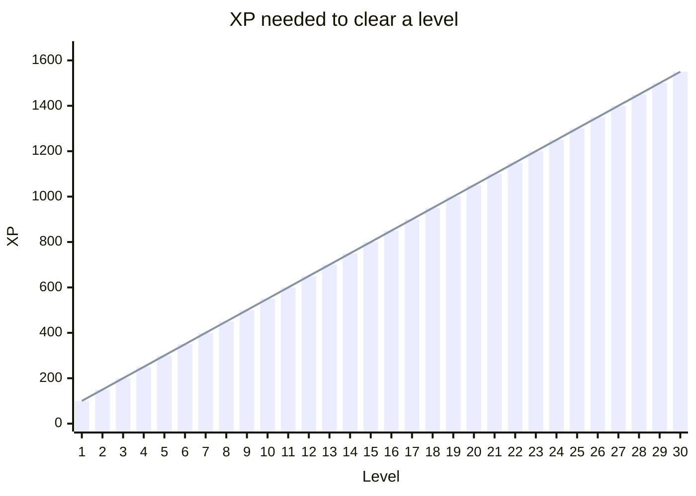

<!-- GENERATED by scripts/gen-docs.js - do not edit by hand. Run `npm run docs:gen`. -->

# Progression

Generated from `game/Progression.js`, `game/Badges.js`, `game/Emotes.js`
and `game/BotQuips.js`; the display names come from the client's own
bilingual tables. Ids are stable, names may change.

## Experience

| Event | XP |
| --- | --- |
| Finishing a match (won or lost) | **10** |
| Winning it (in "2 gegen 2" a team win, for both teammates) | **+50** |
| Final score (always the player's own total, also in a team) | **+1 per 10 points** (never negative) |
| Solving the daily puzzle (once a day, no game counted) | **+30** |
| First star of a Kartenhaus floor (once per floor and month, no game counted) | **+10** |
| Crowning the Kartenhaus (all 20 floors of a month starred, once per month) | **+50** |

Each level costs a little more than the last, so the first levels arrive
after an evening of play and the later ones stay meaningful:

| Level | XP for this level | Total XP to reach it |
| --- | --- | --- |
| 1 | 100 | 0 |
| 2 | 150 | 100 |
| 3 | 200 | 250 |
| 5 | 300 | 700 |
| 10 | 550 | 2700 |
| 20 | 1050 | 10450 |
| 50 | 2550 | 63700 |

Seasons are calendar months; the ladder resets so late starters have
something reachable.

### Season finale

Once a season has ended, its final standings are written down exactly once:
the place comes from season XP, ties share the place. Accounts only, like the
ladder itself. Each account gets one badge per season (the best it reached),
kept for good and named after the season:

| Place | Badge |
| --- | --- |
| 1 | 🥇 Season winner |
| 2 | 🥈 Season silver |
| 3 | 🥉 Season bronze |
| 4 to 10 | 🏅 Season top 10 |
| below, with at least 3 matches that season | 🎟️ Season participant |

The next start shows the result once; the ladder shows last season's place.
Only seasons that ended after the server first ran the finale count (older
rollovers overwrote the numbers); in that first season the game counter
started late, so every ranked account gets at least the last badge.

## Daily quests

**3** of these per game day, the same three for everyone
(seeded from the date, like the challenge deck):

| Id | Task | Count |
| --- | --- | --- |
| `finish_game` | Finish one match | 1 |
| `win_game` | Win a match | 1 |
| `win_rounds_3` | Win 3 rounds | 3 |
| `meld_queen` | Meld a Queen of Spades | 1 |
| `meld_jokers_3` | Meld 3 jokers | 3 |
| `round_150` | Score 150+ in one round | 1 |
| `clean_hands` | Finish a match never caught with the Queen | 1 |
| `hand_aus` | Win a round with "out in one" | 1 |
| `score_400` | Finish a match with 400+ points | 1 |
| `beat_zen` | Beat a table with a zen bot | 1 |

A daily streak survives one missed day every 7 days
(the "joker day"); after 7 days away the app says welcome
back instead of showing a broken streak.

## Badges

**58** badges. 13 of them are *families*: one tile, rising
thresholds on the same counter.

| Family | Counter | Tiers |
| --- | --- | --- |
| `queens` | `totalQueensLaid` | ♠ Queen collector {bdg-secondary}`1` → 🎯 Queen hunter {bdg-secondary}`10` → 🎯 Queen legend {bdg-secondary}`50` |
| `games` | `gamesPlayed` | 🏃 Marathon {bdg-secondary}`10` → 🏃 Long runner {bdg-secondary}`50` → 🏃 Staying power {bdg-secondary}`100` |
| `wins` | `gamesWon` | 🏆 First win {bdg-secondary}`1` → 🏆 Serial winner {bdg-secondary}`10` → 🏆 Table legend {bdg-secondary}`50` |
| `streak` | `winStreak` | 🔥 Winning streak {bdg-secondary}`3` → 🔥 Wildfire {bdg-secondary}`5` → 🔥 Unstoppable {bdg-secondary}`10` |
| `handaus` | `totalHandAus` | 🚀 Out in one! {bdg-secondary}`1` → 🚀 Lightning hand {bdg-secondary}`5` |
| `daily` | `dailyStreak` | 📅 A week running {bdg-secondary}`7` → 🗓️ A month running {bdg-secondary}`30` |
| `hearts` | `gamesLost` | 💜 Brave heart {bdg-secondary}`10` → 💜 Unbreakable {bdg-secondary}`50` → 💜 Heart of gold {bdg-secondary}`100` |
| `challenger` | `totalChallenges` | 🏁 Challenger {bdg-secondary}`7` → 🏁 Challenge pro {bdg-secondary}`30` |
| `puzzles` | `totalPuzzlesSolved` | 🧩 Puzzle fox {bdg-secondary}`7` → 🧩 Puzzle master {bdg-secondary}`30` |
| `puzzlePerfect` | `totalPerfectPuzzles` | 🌟 Star moment {bdg-secondary}`10` → 🌟 Star collector {bdg-secondary}`30` → 🌟 Puzzle ace {bdg-secondary}`100` |
| `tower` | `towerCleared` | 🏠 Card stacker {bdg-secondary}`3` → 🏠 Card artist {bdg-secondary}`6` → 🏠 High stacker {bdg-secondary}`10` |
| `towerStars` | `towerStars` | 🌠 Starry sky {bdg-secondary}`30` |
| `towerCrowned` | `towerCrownedMonths` | 👷 Apprentice {bdg-secondary}`1` → 👷 Foreman {bdg-secondary}`3` → 👷 Master Builder {bdg-secondary}`12` |

The other **25** are earned by a fact about one match (computed in
`computeEarnedBadges` from the finished game record):

| | Badge | Earned by | Id |
| --- | --- | --- | --- |
| 🎩 | **Hat trick** | Melded 3+ Queens of Spades in one game | `pd_triple` |
| 😱 | **Ouch!** | Caught with the Queen of Spades in hand (−100) | `pd_caught` |
| 💯 | **Point royalty** | Finished a game with 500+ points | `score_500` |
| 🐢 | **Comeback** | Last after round 1 - and still won | `comeback` |
| 👯 | **Double queen** | Melded BOTH Queens of Spades in the same round | `double_queen_round` |
| 💥 | **Monster round** | 300+ points in a single round | `round_300` |
| ⚔️ | **Zen slayer** | Won a game with a zen master at the table | `zen_slayer` |
| 🔄 | **Full circle** | Melded a run wrapping K-A-2 | `ring_run` |
| 🌈 | **The whole suit** | Melded a full 13-card run | `run_13` |
| 🍽️ | **Pile glutton** | Picked up 10+ discards and still won the round | `pile_glutton` |
| 🧘 | **Three masters** | Beat three zen masters | `zen_trio` |
| 🃏 | **No jokers** | Won a game without ever melding a joker | `no_joker_win` |
| 😤 | **Red lantern** | Last place in 3 games in a row | `red_lantern` |
| 😡 | **Rock bottom** | Finished a game below zero | `rock_bottom` |
| 🥶 | **Cold shower** | Caught with both Queens of Spades in one round (−200) | `cold_shower` |
| 🤹 | **Joker king** | Melded 4+ jokers in one round | `joker_king` |
| ⚡ | **Lightning start** | Out in one in round 1 | `quick_start` |
| 😅 | **So close** | Lost by less than 20 points | `near_miss` |
| 🏔️ | **Landslide** | Won by 500+ points | `landslide` |
| 🦉 | **Night owl** | Finished a game between midnight and 4 am | `night_owl` |
| 🍻 | **Table regular** | 10 games at a regulars table | `stammtisch_10` |
| 🥇 | **Champion of the day** | First place in a daily challenge | `challenge_champ` |
| 🧲 | **Queen magnet of the day** | Daily challenge: caught with the Queen of Spades the most | `queen_magnet_day` |
| 💎 | **Royal flush** | Melded 10-J-Q-K-A of one suit, no jokers | `royal_flush` |
| 👑 | **Spade royal** | Royal flush in spades - with the Queen of Spades | `pik_royal` |

## Stammtisch goals

A Stammtisch earns points together (`game/StammtischGoals.js`): every
finished match there, "2 gegen 2" too, gives **10**, plus **5** for every further
human at the table (two humans: 15, four: 25). Its level follows the
same shape as the player curve with smaller steps (50 + 25 per level):

| Level | Points for this level | Total points to reach it |
| --- | --- | --- |
| 1 | 50 | 0 |
| 2 | 75 | 50 |
| 3 | 100 | 125 |
| 5 | 150 | 350 |
| 10 | 275 | 1350 |
| 20 | 525 | 5225 |

The weekly goal is **5 matches**, Monday to Sunday of the game day
(Europe/Berlin). Reaching it counts once per week; reached weeks in a row form
the streak, which stays alive through the running week and ends with a
missed one. Tables from before this feature start from their kept match list.

## Table talk

Reactions are a whitelist on the server (a safety filter) and unlock by level
on the client:

| Emote | Unlocked |
| --- | --- |
| 👍 | always |
| 😂 | always |
| 😱 | always |
| 😤 | always |
| 🎉 | always |
| ⏳ | always |
| ♠Q (mini card) | always |
| 👏 | level 2 |
| 🙈 | level 3 |
| 🤔 | level 4 |
| 🍀 | level 5 |
| 😎 | level 6 |
| 🔥 | level 8 |
| 😴 | level 10 |
| 🙏 | level 12 |
| 🤩 | level 14 |
| 🥳 | level 16 |
| 💪 | level 18 |
| 🃏 | level 20 |
| 😅 | level 21 |
| 🤞 | level 22 |
| 👀 | level 23 |
| 🙄 | level 24 |
| 😬 | level 26 |
| 🙃 | level 28 |
| 🤝 | level 30 |
| 😇 | level 32 |
| ☕ | level 34 |
| 🐢 | level 36 |
| 🍻 | level 38 |
| ❤️ | level 40 |

Seasonal extras the client offers in autumn and around New Year: 🎃 🎆
(always accepted server-side). On their holiday everyone also gets 🎅 🎄 🐣
(`game/Holidays.js`). On a configured greeting day (`PIKDAME_BIRTHDAY`) that
account also gets 🎂.

Bots may say a short line at **6** moments
(`round_win`, `hand_aus`, `game_win`, `queen_caught`, `queen_laid`, `big_pile`). Only the moment id travels over the wire;
the lines themselves are in the client, in both languages.

## Victory celebrations

What the whole table sees at the top of the result sheet when a player wins a
round or the match (`game/Celebrations.js`). The signed-in owner of a name
picks one in the settings; the server accepts only these ids, at the
profile's level, and only the id travels over the wire:

| Id | Unlocked |
| --- | --- |
| `standard` | always |
| `cats` | level 10 |
| `fireworks` | level 20 |
| `cardfan` | level 35 |
| `goldqueen` | level 50 |

`standard` is the classic confetti only the winner sees.
