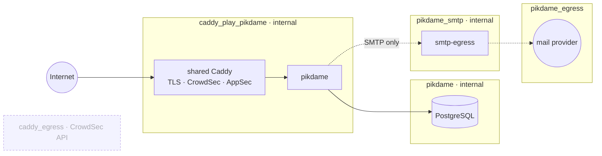

# Operations runbook

The full production runbook: server bootstrap, the app/PostgreSQL stack behind
the shared Caddy ({doc}`shared-caddy`), DNS, auto-updates, health checks and
upgrades.

## Start (Docker)

Everything Docker-specific lives under `docker/` (Dockerfile, compose files,
the shared-Caddy site file, `.env.example`, `secrets/`).

```sh
# Production (shared Caddy -> app -> PostgreSQL; Caddy setup: shared-caddy.md):
cd docker
cp .env.example .env                              # PIKDAME_DOMAIN, SMTP user
echo -n 'strong-password' > secrets/db_password.txt
echo -n 'smtp-password'   > secrets/smtp_password.txt   # optional
docker compose -f docker-compose.prod.yml up -d

# Minimal without a domain (prebuilt image):
docker compose -f docker/docker-compose.ghcr.yml up -d
# Local build:
docker compose -f docker/docker-compose.yml up -d
```

### Secrets policy (which mechanism for what)

- **Compose file secrets** (`docker/secrets/*.txt` → `/run/secrets/…`) for
  real secrets: DB password, SMTP password. They never appear in the
  container environment or `docker inspect`; the app and the Postgres image
  read them via `*_FILE` variables. Files are git-ignored.
- **`.env`** only for non-sensitive configuration: domain, SMTP user,
  feature toggles. Also git-ignored, but treated as config, not as a vault.
- **Docker (Swarm) secrets** would add encrypted-at-rest distribution - only
  relevant if you ever run Swarm; plain Compose file secrets are the right
  fit for a single host.

### Network layout (prod stack, least privilege)

Shared Caddy → `caddy_play_pikdame` (external, internal) ← app → `pikdame`
(internal) ← PostgreSQL; app → `pikdame_smtp` (internal) ← `smtp-egress` →
`pikdame_egress` (internet). The app and the database have **no route to the
internet**; mail leaves only through the egress proxy. Never attach a
Pik Dame container to the shared `caddy_egress`: it sits next to CrowdSec's API.



## Server bootstrap (fresh Ubuntu/Debian host)

One command as root - system updates, unattended-upgrades with a nightly
reboot window (04:30), fail2ban for SSH, UFW (22/80/443), Docker from the
official repository, and the production stack files under
`/opt/pikdame/docker`:

```sh
curl -fsSL https://raw.githubusercontent.com/floriandeutsch89/pikdame-local/main/scripts/server-bootstrap.sh | bash
```

The script prints the remaining one-time steps (fill `.env`, write the two
secret files, join the shared Caddy, `up -d`). It creates the
`caddy_play_pikdame` network; the shared Caddy stack itself is set up per
{doc}`shared-caddy`. After switching to
SSH keys: set `PasswordAuthentication no` and `PermitRootLogin
prohibit-password`, reload sshd, and rotate the root password.

### DNS

Point an **A record** for your domain at the server's IPv4 address
(e.g. `play.pikdame.online -> <server IP>`, TTL 300-3600). A CNAME is only
for pointing at another *name*; for a bare IP an A record is the correct
type. Add an AAAA record only if the host has IPv6. Caddy fetches the TLS
certificate automatically once the record resolves.

## Auto-updates for the stack

**Watchtower** runs in the shared Caddy stack, polls the registry daily at
04:00 and recreates every container on the host that opted in via label: here
the app and PostgreSQL (minor updates). With {doc}`auto-deploy` the same pull
happens right after every release instead of at 04:00.

## CrowdSec, AppSec, rate limits

All in the shared Caddy (`import common` in the site file), see
{doc}`shared-caddy` and the caddy-crowdsec README. Bans and alerts:

```sh
cd /opt/caddy
docker compose exec crowdsec cscli decisions list
docker compose exec crowdsec cscli alerts list
```

## SMTP egress (app stays offline)

The app has **no internet route**. Outbound mail works through a dedicated
`smtp-egress` proxy (socat) that can reach exactly ONE destination:
`smtp.eu.mailgun.org:587`. The app talks to it over the internal
`pikdame_smtp` network; TLS is verified against the real Mailgun hostname
(`PIKDAME_SMTP_TLS_SERVERNAME`), so the proxy cannot be silently swapped.
Different provider? Change the `tcp-connect:` target in the `smtp-egress`
service and the servername env.

### Troubleshooting: `EACCES: permission denied, open '/run/secrets/...'`

Compose file secrets are bind mounts that keep the host file's owner and
mode. The app runs as non-root (UID 10001 since v1.19.3) and cannot read
files owned by root with mode 600. Fix on the host:

```sh
cd /opt/pikdame/docker
chown 10001:10001 secrets/*.txt && chmod 400 secrets/*.txt
docker compose -f docker-compose.prod.yml restart pikdame
```

When upgrading from an image older than v1.19.3 (app UID was 100), also
re-own the data volume once. Plain `exec -u root` is NOT enough - the
container runs with `cap_drop: ALL`, so even root inside it lacks
CAP_CHOWN. Grant capabilities to just this one command:

```sh
docker compose -f docker-compose.prod.yml exec --privileged -u root pikdame chown -R 10001:10001 /app/data
```

## Security model (anti-cheat & hardening)

**IP logging & retention:** the shared Caddy's access log exists solely to feed
CrowdSec. Retention is capped at 48 hours (`roll_keep_for 48h` in its
`(common)` snippet, two 10 MB rolls) to match the privacy policy; keep it that
way when editing the shared stack. The app container itself never logs IP addresses.


The server is fully **authoritative**: every action (draw, meld, lay-off,
discard, joker swap) is validated server-side against the rules, turn order
and phase - clients only *render* state and *request* actions. A modified
client therefore cannot make illegal moves. On top of that:

- **Information hiding:** each player receives an individually filtered
  state - foreign hands are never transmitted (only counts), the draw pile
  is count-only, the discard pile exposes only its top card. What is not
  sent cannot be read from memory or network traffic.
- **Seat protection:** player ids are public (needed for rendering), so
  reclaiming a seat additionally requires a secret per-seat token
  (crypto-random, issued at join, stored only in the owner's browser,
  persisted across server restarts via the session snapshot). Guessing
  tokens counts towards the per-IP failed-join limit.
- **Abuse limits:** per-IP join-failure blocking (session-code brute force),
  per-connection message throttling (~25 msg/s soft, 60 hard close),
  16 KB websocket payload cap, name sanitization, emote whitelist,
  account-endpoint rate limiting.
- **Cost of cheating vs. performance:** all checks are O(1) or O(hand size)
  per action - there is no speculative simulation or per-tick server work,
  so the protections add no measurable load.

What is intentionally NOT prevented: players screensharing their hand or
sitting next to each other - no online game can stop analog cheating.

## Update & rollback

**Stack files changed in the repo** (compose, site file, scripts) - one
command fetches and rolls out everything, leaving `.env` and `secrets/`
untouched:

```sh
curl -fsSL https://raw.githubusercontent.com/floriandeutsch89/pikdame-local/main/scripts/server-update.sh | bash
```

**Automatically after every merge to `main`:** set up once as described in
{doc}`auto-deploy` - the release workflow then pulls the new images and
checks that the new version is live. It never fetches stack files: after a
change to compose or the site file, run the command above by hand.

**Images only** (or just wait for the nightly Watchtower run):

```sh
cd /opt/pikdame/docker
docker compose -f docker-compose.prod.yml pull
docker compose -f docker-compose.prod.yml up -d
```

Running games survive the update: on stop the server writes a session
snapshot (`stop_grace_period: 30s` gives it time) and restores it on the next
start. **Rollback:** pin the image tag in the compose file from `:latest` to
the last good version (e.g. `:v1.12.0`) and run `up -d` again — every release
version is available as its own tag on GHCR.

**Rolling back past the daily-challenge move** (to a version that still kept
`challenges.json`): the first start of the newer version imported the file and
renamed it to `challenges.json.migrated` in the data volume. Rename it back
before starting the old version; challenge results played on the newer version
exist only in PostgreSQL and are not in the file. Going forward again does not
re-import the file (marker in `legacy_imports`, the file is just moved aside);
to import it once more, `DELETE FROM legacy_imports WHERE source = 'challenges.json'`
first.

**Rolling back past the profile move** (to v2.111 or older, which kept
`players.json`): the first start of the newer version imported the file and
renamed it to `players.json.migrated`, and gave the challenge and play-attempt
tables a required `player_id`. Before starting the old version:

```bash
# in the data volume
mv players.json.migrated players.json
```

```sql
-- the old version inserts challenge rows and play attempts without player_id
ALTER TABLE challenge_results ALTER COLUMN player_id DROP NOT NULL;
ALTER TABLE challenge_attempts ALTER COLUMN player_id DROP NOT NULL;
ALTER TABLE play_attempts ALTER COLUMN player_id DROP NOT NULL;
```

Profile progress made on the newer version is not in the file. Going forward
again keeps the database's profiles: the file is moved aside without importing
it a second time (marker `players.json` in `legacy_imports`; never delete it,
the import adds the file's counters to the existing ones). Link the rows the
old version wrote and make the column required again:

```sql
INSERT INTO players (player_key, player_name, created_at)
SELECT DISTINCT ON (player_key) player_key, player_name, NULL
  FROM (SELECT player_key, player_name FROM challenge_results WHERE player_id IS NULL
        UNION ALL SELECT player_key, player_name FROM challenge_attempts WHERE player_id IS NULL
        UNION ALL SELECT player_key, player_name FROM play_attempts WHERE player_id IS NULL) n
 ORDER BY player_key ON CONFLICT (player_key) DO NOTHING;
UPDATE challenge_results c SET player_id = p.id FROM players p WHERE c.player_id IS NULL AND p.player_key = c.player_key;
UPDATE challenge_attempts c SET player_id = p.id FROM players p WHERE c.player_id IS NULL AND p.player_key = c.player_key;
UPDATE play_attempts a SET player_id = p.id FROM players p WHERE a.player_id IS NULL AND p.player_key = a.player_key;
ALTER TABLE challenge_results ALTER COLUMN player_id SET NOT NULL;
ALTER TABLE challenge_attempts ALTER COLUMN player_id SET NOT NULL;
ALTER TABLE play_attempts ALTER COLUMN player_id SET NOT NULL;
```

**Rolling back past the account conventions** (migration `008`, also needed
before going back past the profile or Stammtisch move): the old version reads
the account tables in their old shape. Stop the app, then run in one go
(sign-ins, passkeys and season results stay; times back to milliseconds):

```sql
BEGIN;
DROP INDEX users_verify_token_idx, users_login_token_hash_idx, users_review_unsub_hash_idx,
  users_verify_expires_at_idx, login_sessions_created_at_idx, login_sessions_user_id_idx;
ALTER INDEX users_lower_username_key RENAME TO users_username_lower;
ALTER INDEX users_lower_email_key RENAME TO users_email_lower;
ALTER INDEX users_season_season_xp_idx RENAME TO users_season_xp;
ALTER INDEX webauthn_credentials_user_id_idx RENAME TO webauthn_credentials_user;
ALTER TABLE users DROP COLUMN player_id, DROP COLUMN updated_at, ALTER COLUMN created_at DROP DEFAULT,
  ALTER COLUMN created_at TYPE BIGINT USING (extract(epoch FROM created_at) * 1000)::bigint,
  ALTER COLUMN verify_expires_at TYPE BIGINT USING (extract(epoch FROM verify_expires_at) * 1000)::bigint,
  ALTER COLUMN login_expires_at TYPE BIGINT USING (extract(epoch FROM login_expires_at) * 1000)::bigint,
  ALTER COLUMN verify_code_expires_at TYPE BIGINT USING (extract(epoch FROM verify_code_expires_at) * 1000)::bigint,
  ALTER COLUMN review_mail_changed_at TYPE BIGINT USING (extract(epoch FROM review_mail_changed_at) * 1000)::bigint;
ALTER TABLE users RENAME COLUMN password_salt TO salt;
ALTER TABLE users RENAME COLUMN email_verified TO verified;
ALTER TABLE users RENAME COLUMN games_played TO games;
ALTER TABLE users RENAME COLUMN games_won TO wins;
ALTER TABLE users RENAME COLUMN verify_expires_at TO verify_expires;
ALTER TABLE users RENAME COLUMN login_expires_at TO login_expires;
ALTER TABLE users RENAME COLUMN verify_code_expires_at TO verify_code_expires;
ALTER TABLE users RENAME COLUMN review_mail_changed_at TO review_mail_at;
ALTER TABLE login_sessions ALTER COLUMN created_at DROP DEFAULT,
  ALTER COLUMN created_at TYPE BIGINT USING (extract(epoch FROM created_at) * 1000)::bigint;
ALTER TABLE login_sessions RENAME CONSTRAINT login_sessions_pkey TO sessions_pkey;
ALTER TABLE login_sessions RENAME CONSTRAINT login_sessions_user_id_fkey TO sessions_user_id_fkey;
ALTER TABLE login_sessions RENAME COLUMN session_token TO token;
ALTER TABLE login_sessions RENAME TO sessions;
ALTER TABLE webauthn_credentials DROP COLUMN updated_at, ALTER COLUMN created_at DROP DEFAULT,
  ALTER COLUMN created_at TYPE BIGINT USING (extract(epoch FROM created_at) * 1000)::bigint,
  ALTER COLUMN last_used_at TYPE BIGINT USING (extract(epoch FROM last_used_at) * 1000)::bigint;
ALTER TABLE webauthn_credentials RENAME COLUMN credential_id TO id;
ALTER TABLE webauthn_credentials RENAME COLUMN credential_name TO name;
ALTER TABLE webauthn_credentials RENAME COLUMN sign_count TO counter;
ALTER TABLE season_finals ALTER COLUMN finalized_at TYPE BIGINT USING (extract(epoch FROM finalized_at) * 1000)::bigint;
ALTER TABLE season_results DROP COLUMN updated_at;
ALTER TABLE season_meta RENAME COLUMN meta_key TO key;
ALTER TABLE season_meta RENAME COLUMN meta_value TO value;
DELETE FROM schema_migrations WHERE version = 8;
COMMIT;
```

Going forward again applies `008` once more and links the accounts anew.

**Rolling back past the Stammtisch move** (to a version that still kept
`stammtisch.json`): rename `stammtisch.json.migrated` back to
`stammtisch.json` in the data volume before starting the old version. Matches,
members and new tables of the newer version are not in the file. Going forward
again keeps the database's Stammtische (marker `stammtisch.json` in
`legacy_imports`, the file is moved aside).

## Backup & restore

```sh
./scripts/backup.sh docker/docker-compose.prod.yml     # creates pikdame-backup-<stamp>.tar.gz
./scripts/restore.sh pikdame-backup-<stamp>.tar.gz docker/docker-compose.prod.yml
```

The backup stops the app container for a few seconds — this guarantees a
consistent archive of the data volume (flushed JSON stores). The script
additionally writes a `pg_dump` of the PostgreSQL database
(`pikdame-pgdump-<stamp>.sql.gz`) — accounts, profiles and the challenge live
there, so keep both files.
Recommendation: run nightly via cron and copy the archive off-site.

## Observability

- `GET /healthz` — liveness (also used by the Docker healthcheck)
- `GET /statusz` — version, session/player counts, memory, accountsEnabled, today's quests and the
  holiday decor windows for today/tomorrow (`occasions`, German game day)
- Logs: `docker logs -f pikdame` (rotation 10 MB × 3 is configured)
- Crash diagnostics: `data/crash.log` inside the volume

## Kubernetes

The recommended path is the Helm chart (`helm/pikdame`, published as an OCI
artifact on GHCR with every release):
`helm install pikdame oci://ghcr.io/floriandeutsch89/charts/pikdame`.
Raw manifests are available as an alternative under `k8s/` (Deployment,
Service, Ingress with WebSocket timeouts, PVC). **Key point: one replica,
strategy Recreate** — sessions live in RAM; PostgreSQL comes from a Secret; details in
`k8s/README.md`.

## Best-practice checklist (beyond the stack itself)

- **Off-site backups**: `scripts/backup.sh` via nightly cron, copy the
  archives off the host (object storage, another machine).
  `0 3 * * * cd /opt/pikdame && ./scripts/backup.sh docker/docker-compose.prod.yml`
- **Uptime monitoring**: point an external monitor at `https://<domain>/healthz`.
- **SSH keys** instead of passwords; rotate any password that was ever
  shared in plain text.
- **Mail deliverability**: set up SPF/DKIM/DMARC for the sending domain in
  Mailgun - confirmation mails land in spam otherwise.
- **Public server?** Consider `PIKDAME_PUBLIC_MODE=1` (disables profiles/
  teams/statistics for anonymous strangers).
- **Image pinning**: replace `:latest` with `:vX.Y.Z` once the setup is
  stable and let Watchtower handle only conscious tag bumps - or keep
  `:latest` for convenience on a low-stakes host.

## Security

OWASP hardening, CI scans and host responsibilities: see `SECURITY.md`.

