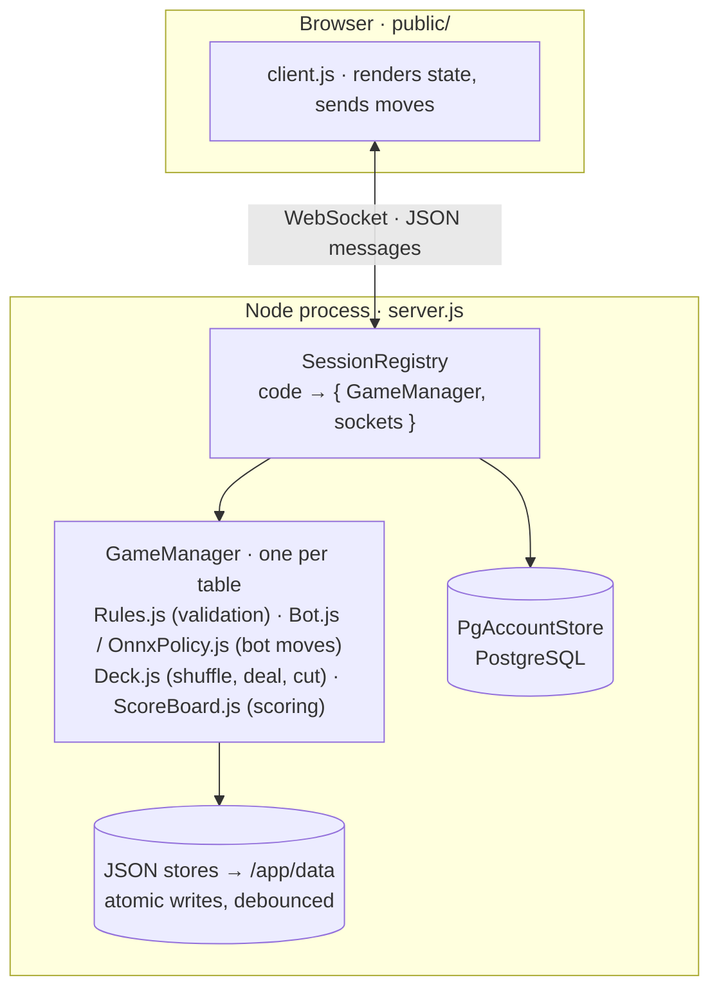
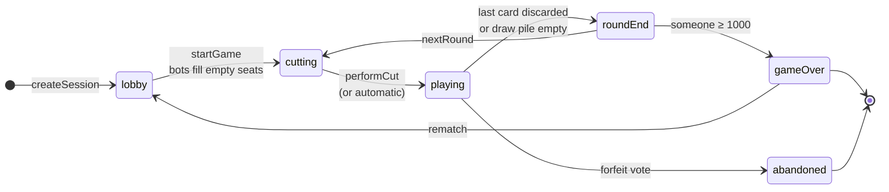
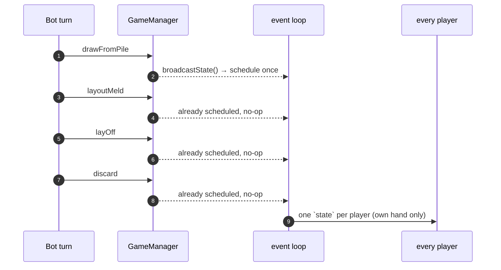

# Architecture

## The shape of it

One `GameManager` per table, held in memory, keyed by the six-character session
code. Tables are fully isolated: a manager's broadcast function only reaches the
sockets of its own session.

## A table's life

The phase field on the manager is the whole state machine. `abandoned` is
reachable from everywhere (forfeit vote, nobody left to play).

## Principles that shaped the code

### The server is the only source of truth

Every move is validated server-side. The client is a renderer plus an input
device; it is never trusted. Concretely:

- A player's state contains **their own hand only** — other players are reduced
  to card *counts*. You cannot cheat by reading the WebSocket.
- Control fields that a client might inject (bot tuning knobs, difficulty, …) are
  **stripped** from incoming messages before they are used.
- Illegal moves are rejected with a reason; the client shows it and the state
  stays consistent.

### No framework, no build step

The client is plain JS. This is a deliberate trade: no bundler, no transpiler, no
dependency churn — at the cost of writing some DOM code by hand. It keeps the
image small and the project maintainable years from now.

### State broadcasts are coalesced

A single bot turn changes the game several times (draw → meld → lay off →
discard). Broadcasting after each step meant up to four full states per player
per turn, even though nobody can see the intermediate ones — they happen in the
same tick. `broadcastState()` therefore schedules **one** send per tick
(`setImmediate`), which cut broadcast volume by ~63 % under load.

The canonical **sorting** of table melds stays *synchronous*, because it is game
state, not a network detail.

### Games survive deployments

Every table is serialised into `sessions-snapshot.json` on the data volume —
every 60 s while anything changed, and once more on `SIGTERM`. On the next start
they are restored (snapshots older than 30 minutes are discarded) and clients
reconnect on their own (they keep the session code and their player id). That is what makes a nightly
auto-update safe.

### One process, on purpose

Game state lives in memory. That means **you cannot scale to two replicas** by
just adding one — players would land on a process that doesn't know their table.
Measurements (`scripts/load-test.js`) show a single process handles 200 concurrent
games with a median event-loop lag of 0 ms, so the complexity of a shared store
is not worth it yet. If it ever is, the honest path is session affinity plus an
external state store — not a quick hack.

## Persistence

Small JSON files, written **atomically** (temp file + rename) and **debounced**
(~800 ms), so a busy server does not hammer the disk. On shutdown — and after an
uncaught exception — everything is flushed synchronously, so nothing is lost.

Accounts and the daily challenge are the exception: they live in PostgreSQL,
which the server requires. All stores share one pool (`game/Database.js`); the
schema comes from numbered files in `migrations/` (see {doc}`migrations`).
PostgreSQL writes are awaited, never buffered: the challenge's "one ranked
attempt per name and day" is the primary key of `challenge_attempts`, so two
racing starts can never both be ranked. A JSON file moved into the database is
imported once on the first start (marker row in `legacy_imports`) and then
renamed to `<file>.migrated`.

Play attempts (`play_attempts`, {doc}`../admin/play-attempts`) are the one write
nobody waits for: `game/PlayEvents.js` stores them in the background, a failed
insert is logged and never holds up a game; a unique `attempt_id` keeps a
replayed snapshot from writing an attempt twice. Rows older than 90 days are
deleted every few hours. Three modes write them: a Kartenhaus floor and a
tutorial table report their end through the engine's `onAttemptEnd` hook (the
tutorial's lessons come from the client's `tutorialStep` reports, checked
against `game/TutorialSteps.js`); daily-puzzle attempts have no table, so
`game/PuzzleAttempts.js` keeps the open ones in memory and in the session
snapshot until the solve, the shown solution or midnight.

## Testing

`node --test`, no framework, against a real PostgreSQL (`PIKDAME_TEST_PG_URL`,
one schema per test via `test/helpers/test-db.js`). Roughly 1,080 tests covering rules, scoring, the bot,
session handling, persistence, and end-to-end game loops. Notably there are tests
that play **thousands of complete bot games** and assert invariants — that is how
the "bot must lay a taken discard card" rule violation was caught and fixed.
