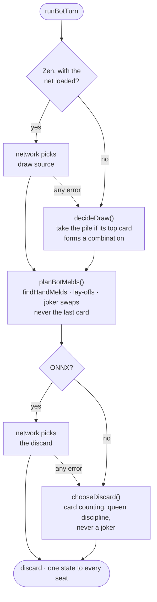

# Bots

Four difficulty levels, each measurably stronger than the one below. Three are
**heuristic** — hand-written rules for drawing, melding and discarding. Zen lets
a trained **ONNX policy** make the draw and discard decisions where the runtime
is installed ({doc}`../admin/onnx`) and falls back to the Hard heuristic
otherwise; melding stays with the engine either way, because a meld is either
legal or not. At a "2 gegen 2" table only a model with the team features
(encoder v2, {ref}`training-v2`) plays; with the shipped v1 model Zen plays
its heuristic there. New tables start on Medium.

| Level | Engine | Step up (2 vs 2, win share of the stronger level) |
| --- | --- | --- |
| Leicht (`easy`) | heuristic, random discards, often misses the pile | — |
| Mittel (`medium`) | heuristic value play | 88.7 % ± 0.8 over Leicht |
| Schwer (`hard`) | heuristic with card counting (the old zen heuristic) | 57.4 % ± 0.7 over Mittel |
| Zen (`zen`) | trained network | 77.5 % ± 0.8 over Schwer |

Measured 2026-10-17 with the net active (the prod default), 10 batches × 300
paired games per step, ± = standard error of the batch means:

```bash
node scripts/sim-bots.js --ladder            # needs onnxruntime-node for Zen
node scripts/sim-bots.js --ladder medium,hard --batches 10 --games 300
node scripts/sim-bots.js --team-ladder hard,zen   # "2 gegen 2": a Zen team against a Schwer team
```

Before 2.61 Medium also played the net. Medium and Zen nets were equally strong
(50.6 % ± 1.3), so the game effectively had two levels: Leicht and "the net".
The daily challenge always plays heuristic Medium.

## One bot turn



Every network call is guarded: an exception, a missing model or a missing
runtime falls back to the heuristic for that decision, and the server says so
once in the log.

## The rule: bot changes are measured, never guessed

Any change to how a bot *chooses* moves must be **A/B-measured in self-play**
before it ships. Presentation-only changes (emotes) and pure correctness fixes do
not need this — behavioural changes do.

The harness plays paired games: in the *same* games, two seats get the variant
and two stay baseline. That controls for game-to-game variance.

```bash
node scripts/sim-ab.js 5000 <knob> <value>
```

It reports the variant's win share (50 % = no effect) with a standard error, plus
the average score margin.

## A rule change the bots missed

Until 2.61 the discard heuristic avoided every card that fit an opponent's meld,
on the belief that this lets the next player take the whole pile. The rule had
long been different: only a **new** meld with hand cards allows the pickup
(`GameManager.canUseDiscardTop`), laying off never does. The filter only made
the bots keep the wrong cards. Removing it (and the same check for the Queen of
Spades in the endgame) measured, in paired self-play:

| Bot | Win share without the filter |
| --- | --- |
| Medium | 70.6 % ± 0.8 (n = 3000) |
| Zen heuristic | 73.4 % ± 0.8 (n = 3000) |

It also uncovered the counting heuristic: before, zen beat medium by 53.1 %
± 1.4, after the fix by 58.7 % ± 1.3. Lesson: when a rule changes, search the
bot code (comments included) for reasoning built on the old rule.

## Ideas that were measured and rejected

This is the interesting part. Several plausible-sounding tactics were implemented,
measured over 5000 games each (4 × the strongest bot), and **not shipped** because
the data said no. They remain in the code as off-by-default knobs.

| Idea | Result | Verdict |
| --- | --- | --- |
| Dump the Queen of Spades a bit earlier in the endgame (hand ≤ 5 instead of ≤ 6) | 50.24 % win share (z = 0.34) | {bdg-secondary}`no effect` the situation is too rare to matter |
| Prefer the draw pile for the first few turns (more chance at an unseen Queen) | 44.58 % (z = −7.71), **−30 pts** | {bdg-danger}`clearly worse` |
| Discard spades J/K more freely once an opponent has laid a joker | 50.34 % (z = 0.48) | {bdg-secondary}`no effect` |
| If taking the discard would only form *another* set while you already have one, draw instead | 46.08 % (z = −5.56), **−33 pts** | {bdg-danger}`clearly worse` |
| Monte-Carlo rollouts for the discard (`MonteCarlo.js`, `Rollout.js`) | ~+2 pts, 0.8 σ | {bdg-secondary}`not significant` infrastructure kept behind a flag |
| "2 gegen 2": team lead instead of own lead, partner's known cards no danger (seat flag `teamAware`, {doc}`team-mode`) | hard 49.4 % ± 0.4, zen heuristic 49.6 % ± 0.3 (20 × 500 team games to 2000; to 1000: 49.8 / 49.9 %) | {bdg-secondary}`no effect` |

### The recurring lesson

Two independent ideas both amounted to *passing up a guaranteed meld from the
discard pile in order to gamble on a random draw* — and both cost about **30
points**. Laying cards down is real progress toward going out, and taking the pile
hands you extra material on top. A random card guarantees neither.

The current rule — *take the discard whenever its top card forms a combination* —
is therefore well supported by data, not just intuition.

## Adding a bot change

1. Add it as an **off-by-default option** on `Bot.decideDraw` / `Bot.chooseDiscard`,
   plumbed from a per-seat field in `GameManager`.
2. Add the field name to the anti-cheat sanitiser (clients must not be able to set
   it).
3. Measure:
   ```bash
   node scripts/sim-ab.js 5000 myNewKnob true
   ```
4. Ship the new default **only** if the win share is significantly above 50 %.
   Otherwise keep it off and document the measurement (that is a useful result
   too — see the table above).

:::{tip}
Measure with the ONNX policy active, because that is what production plays:
with the network, *medium* and *zen* are equally strong (measured 2026-10,
1000 games each). Install `onnxruntime-node` outside the repository
(`--ignore-scripts`, `NODE_PATH`) so `npm test` does not pick it up.
:::
