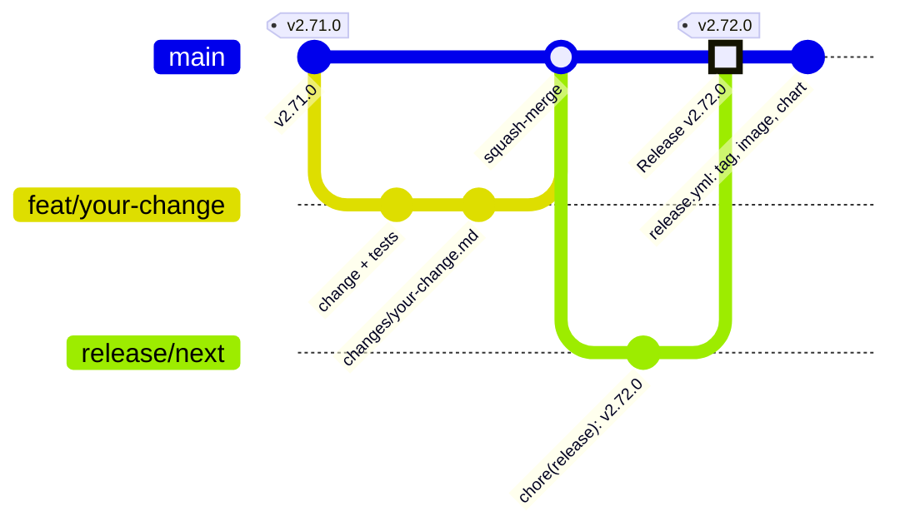
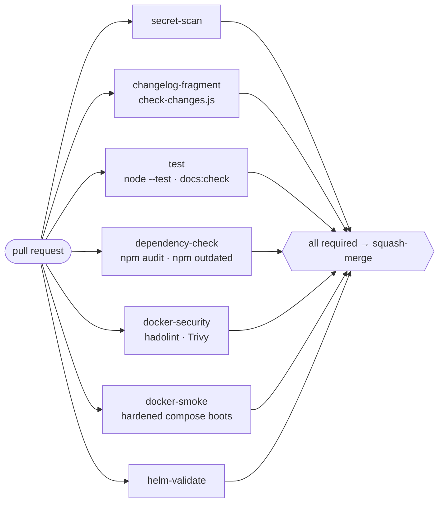

# Contributing

## Workflow



1. Branch off `main` (`feat/…`, `fix/…`, `perf/…`, `chore/…`). Work that
   depends on an open pull request is **stacked**: branch off that PR's
   branch and use it as the base. Independent work is never stacked.
2. Make the change **plus tests**.
3. `npm test` — everything green.
4. If the game changes (`public/`, `server.js`, `game/`, `models/`,
   `docker/`, dependencies): add a **changelog fragment** `changes/<topic>.md`
   — format in [`changes/README.md`](https://github.com/floriandeutsch89/pikdame-local/blob/main/changes/README.md).
   Never edit the version or `CHANGELOG.md`; documentation, tests and CI
   need no fragment.
5. Open a PR. CI runs the suite; the branch must be **up to date with
   `main`** before it can merge (*Update branch* on GitHub when there is no
   conflict). Squash-merge when green.

### Releases

Every push to `main` rebuilds the pull request **Release vX.Y.Z** on the
bot-owned branch `release/next` (`.github/workflows/release-pr.yml`):
`scripts/release.js` turns all fragments into the version bump and the new
`CHANGELOG.md` section, and deletes them. Minor and patch releases merge
themselves once CI is green; a major release (only with
`<!-- bump: major -->` in a fragment) waits for a review. That merge is the
release: `release.yml` tags the version, publishes the image and the chart,
and deploys ({doc}`../releases`).

```bash
node scripts/release.js --dry-run   # the next version and section, from the fragments
node scripts/check-changes.js       # what CI says about your branch
```

Parallel pull requests therefore never conflict over the version or the
changelog, and the merge order does not matter.

### What CI runs on every pull request



`test` includes `npm run docs:check`: the generated documentation pages must
match the code (see below). `changelog-fragment` fails when a game change
has no fragment, a fragment is malformed, or a pull request other than the
release PR edits the version or a released `CHANGELOG.md` section.

## Dependency updates (Dependabot)

Updates are not raised by hand. `.github/dependabot.yml` checks npm, the Docker
base images, the images used in the compose files and the GitHub Actions every
Monday at 03:00 UTC; `.github/workflows/dependabot-auto.yml` then does the two
things Dependabot cannot:

- it adds the changelog fragment `changes/deps-<PR>.md` (one German
  `### Changed` line; patch updates carry `<!-- bump: patch -->`), so the
  update reaches the next release PR — without it the merged update would
  never produce a tag or an image;
- it enables auto-merge for **minor and patch** updates. **Major** updates
  (a new Node base image, a Postgres major) get a label, a reviewer and a
  comment listing what has to move with them; they never merge on their own.

npm updates are deliberately **grouped**: the CI job `dependency-check` runs
`npm outdated` and fails while any package is behind, so one pull request per
package would keep every pull request red.

:::{dropdown} One-time setup of the Dependabot GitHub App
:icon: gear

The workflow acts through a **GitHub App token**, not `GITHUB_TOKEN`: GitHub
does not start workflow runs for events created with `GITHUB_TOKEN`, so the
fragment commit would never be tested and the merge would never reach the
release PR. The release PR (`release-pr.yml`) uses the same App, for the
same reason. An App token also has no expiry date, unlike the personal
access token used before.

1. **Register the App** — *Settings → Developer settings → GitHub Apps → New
   GitHub App*, on the account that owns the repository:

   | Field | Value |
   | --- | --- |
   | GitHub App name | e.g. `pikdame-deps-bot` (must be unique across GitHub) |
   | Homepage URL | the repository URL — the form requires something here |
   | Callback URL | *empty* — the App never signs a user in |
   | Request user authorization (OAuth) during installation | off |
   | Enable Device Flow | off |
   | Setup URL | *empty* |
   | **Webhook → Active** | **off** — on by default and it demands a URL |
   | Where can this App be installed? | Only on this account |

2. **Repository permissions** — everything else stays *No access*:

   | Permission | Level | Why |
   | --- | --- | --- |
   | Metadata | Read-only | mandatory, selected automatically |
   | Contents | Read and write | push the bump commit onto the PR branch |
   | Pull requests | Read and write | enable auto-merge, request a reviewer, comment |
   | Issues | Read and write | the label API for pull requests lives under issues |
   | Workflows | Read and write | required to merge the `github-actions` update PRs, which change files under `.github/workflows/` |

   Do **not** grant *Administration*: the App has no business bypassing branch
   protection.

3. **Create it**, note the numeric **App ID** at the top of the page, then
   *Generate a private key* — a `.pem` file is downloaded. It is shown once.

4. **Install it**: *Install App* → this account → *Only select repositories* →
   this repository.

5. **Store the credentials as _Dependabot_ secrets** — *Settings → Secrets and
   variables → **Dependabot*** — **and the same two as _Actions_ secrets**:
   workflow runs triggered by a Dependabot pull request read only the
   Dependabot store, the release PR workflow (a push to `main`) only the
   Actions store.

   | Secret | Value |
   | --- | --- |
   | `DEPS_BOT_APP_ID` | the numeric App ID |
   | `DEPS_BOT_PRIVATE_KEY` | the **entire** `.pem` file including the `-----BEGIN`/`-----END` lines |

6. **Repository settings**: enable *Allow auto-merge* (*Settings → General →
   Pull Requests*), and protect `main` with **required status checks**
   (`test`, `dependency-check`, `docker-security`, `docker-smoke`, optionally
   `changelog-fragment`) with **Require branches to be up to date before
   merging**, but **no required approvals** — without required checks GitHub
   merges an auto-merge pull request immediately, and required approvals
   would put the manual step back in.

7. **Create the labels** `dependencies`, `docker`, `github-actions` and
   `needs-review`; Dependabot silently ignores labels that do not exist.
:::

## House rules for the code

**Language.** Code, comments, commit messages and this documentation are in
**English**. The app's user-facing text is **German** (with English
translations in `public/i18n.js`); the changelog is German because it is read by
the people who play the game.

**Tests are not optional.** Every bug fix gets a regression test that fails
before the fix. Several subtle rule bugs were only caught by tests that play
thousands of complete bot games and assert invariants — that style is encouraged.

**Bot behaviour must be measured.** See {doc}`bots`. A change to how bots choose
moves does not ship on a hunch, however plausible. Measure it; if it does not
help, say so and keep the default.

**Never trust the client.** Anything arriving over the WebSocket is hostile until
validated. New control fields must be added to the sanitiser.

**External packages only when they are really sensible and necessary.** That
means: building it ourselves would be security-critical or error-prone
(cryptography, protocol parsers, time-series charts) or clearly much more code,
*and* the package is established, maintained, permissively licensed
(MIT/BSD/Apache) and pure JavaScript. Before adding one, check the licences of
the whole tree, its size, a Trivy scan and that it loads with `require`. Load
it lazily and let the feature switch itself off when it is missing.

Today the server has `ws`, `pg` (lazy, only with `PIKDAME_DATABASE_URL`) and
`@simplewebauthn/server` (lazy, passkeys). Browser libraries are **vendored**
unchanged as `public/vendor-*.js` with the npm integrity hash in the header —
never installed for the client, never loaded from a CDN: QR codes, uPlot,
`@simplewebauthn/browser`. The one display font (Rubik, OFL-1.1, for the
wordmark, titles and big scores) is vendored the same way in `public/fonts/`,
unchanged, with its licence and hash in `public/fonts/README.md`; body text
stays on the system font stack.

## Documentation

The docs live in `docs/` and are built with Sphinx + MyST (Markdown) on Read
the Docs, with sphinx-design for tabs, cards and badges and Mermaid for the
diagrams — every diagram is text in the page source, so it is reviewed in the
same diff as the code it describes.

Pages that must never drift from the code are **generated** by
`scripts/gen-docs.js` from the source itself and committed under
`docs/_generated/`:

| Page | Generated from |
| --- | --- |
| {doc}`../admin/configuration` | every `process.env.*` read in `server.js` and `game/` |
| {doc}`protocol` | the message handlers in `server.js` (both directions) |
| {doc}`game-constants` | `Deck.js`, `Card.js`, `Rules.js`, `ScoreBoard.js` — including the deck you can shuffle |
| {doc}`progression` | `Progression.js`, `Badges.js`, `Emotes.js`, `BotQuips.js` plus the client's names |
| the tiles on the {doc}`landing page <../index>` | all of the above |

```bash
npm run docs:gen      # regenerate docs/_generated/*.md
npm run docs:check    # fails if they are stale (CI runs this)
```

If you change an env var, a protocol message, a game constant or a badge, run
`npm run docs:gen` and commit the result — otherwise CI will fail. The
check is byte-exact on purpose: documentation that *silently* lies is worse
than none.

### Building the docs locally

::::{tab-set}

:::{tab-item} Linux / macOS
```bash
# One-time: create a venv and install dependencies
uv venv docs/.venv
uv pip install --python docs/.venv/bin/python -r docs/requirements.txt sphinx-autobuild

# Live-reload server → http://127.0.0.1:8000
docs/.venv/bin/sphinx-autobuild docs docs/_build/html

# Or a one-shot build → docs/_build/html/index.html
docs/.venv/bin/sphinx-build -b html docs docs/_build/html
```
:::

:::{tab-item} Windows
```powershell
uv venv docs/.venv
uv pip install --python docs/.venv/Scripts/python.exe -r docs/requirements.txt sphinx-autobuild

docs/.venv/Scripts/sphinx-autobuild.exe docs docs/_build/html
# or
docs/.venv/Scripts/sphinx-build.exe -b html docs docs/_build/html
```
:::

::::

The Mermaid library is loaded from jsdelivr **by the docs pages only**; the
game itself never loads anything from a CDN.

## Reporting bugs

Open an issue with: what you did, what happened, what you expected. For game-rule
bugs, the exact card situation is gold — a screenshot of the table, or the
exported game JSON (there is a **Spielverlauf exportieren** button at game end),
makes it reproducible in a test.
