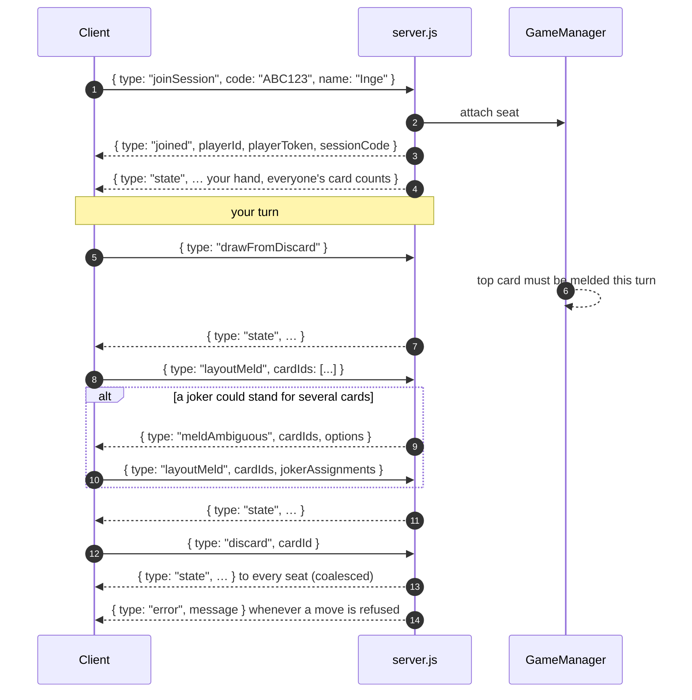

# WebSocket protocol

One socket per player, JSON both ways, `type` decides. This is what a human
turn looks like on the wire; the bot in the same seat produces the identical
sequence.



A `joinSession` carries `playerId` and `playerToken` from local storage when
the player is coming back; that is how a reconnect finds its seat again after
a server restart or a tunnel.

::::{tab-set}

:::{tab-item} Create a table
```json
{ "type": "createSession", "name": "Uwe" }
```
Answered with `joined`; the `sessionCode` is what you share.
:::

:::{tab-item} Join one
```json
{ "type": "joinSession", "code": "ABC123", "name": "Inge",
  "playerId": "…", "playerToken": "…" }
```
`playerId`/`playerToken` are optional and only set on a reconnect. A
Stammtisch code (`ST…`) is resolved here as well.
:::

:::{tab-item} Lay out a meld
```json
{ "type": "layoutMeld", "cardIds": ["S7-0", "S8-1", "JOKER-2"],
  "jokerAssignments": { "JOKER-2": "9" } }
```
Card ids are stable for a round (`<suit><rank>-<deck>`), jokers are
`JOKER-<n>`. The assignment (joker id → rank it stands for) is only needed
when the server answered `meldAmbiguous`.
:::

::::

```{include} ../_generated/protocol.md
:start-line: 3
```
