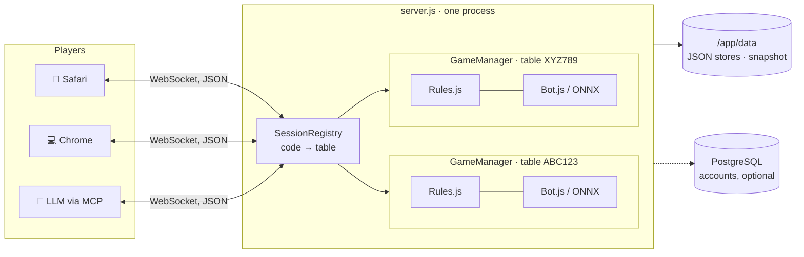

# Pik Dame

**Pik Dame** is a self-hosted, real-time multiplayer card game — the German
family variant of **Rommé** where the Queen of Spades is worth 100 points, for
better or worse. It runs in the browser, needs no app store, and plays 2–4
people across devices, filling empty seats with bots.

{{ version_badge }} {bdg-success-line}`MIT` {bdg-secondary-line}`Node ≥ 22` {bdg-secondary-line}`no build step` {bdg-secondary-line}`amd64 + arm64` {bdg-secondary-line}`DE / EN`

**▶ Live demo: [play.pikdame.online](https://play.pikdame.online)**

::::{grid} 2
:gutter: 3

:::{grid-item-card} {octicon}`rocket;1.2em;sd-text-primary` Getting started
:link: getting-started
:link-type: doc

Run it with Docker in a minute, or the full production stack with automatic TLS.
:::

:::{grid-item-card} {octicon}`tools;1.2em;sd-text-primary` Admin manual
:link: admin/index
:link-type: doc

Configuration, backup & restore, ONNX bots, monitoring, upgrades.
:::

:::{grid-item-card} {octicon}`code;1.2em;sd-text-primary` Developer guide
:link: developer/index
:link-type: doc

Architecture, WebSocket protocol, LLM players via MCP, contributing, running the tests.
:::

:::{grid-item-card} {octicon}`question;1.2em;sd-text-primary` FAQ
:link: faq
:link-type: doc

Fairness of the shuffle, data privacy, bots, scaling.
:::

::::

## In numbers

Counted from the source at build time, not typed in ({doc}`how <developer/contributing>`):

```{include} _generated/numbers.md
:start-line: 2
```

## The shape of it

One Node process, one WebSocket per player, one `GameManager` per table. The
client renders; the server decides.



## What it is

- **Real multiplayer, no accounts required.** Create a game, share the link or
  the six-character code, play. Accounts are optional and only add profiles and
  statistics.
- **Bots that hold up.** Four difficulty levels, each measurably stronger than
  the one below (Zen plays a trained net); every behavioural change to them is
  A/B-measured in self-play before it ships (see {doc}`developer/bots`).
- **Self-hosted.** One container plus a volume. No telemetry, no ads, no
  third-party services in the game path.
- **Survives deployments.** Running tables are snapshotted and restored across
  restarts, so a `docker pull` mid-game does not kill the round.

```{toctree}
:hidden:
:caption: Start here

overview
getting-started
```

```{toctree}
:hidden:
:caption: Admin manual

Overview <admin/index>
```

```{toctree}
:hidden:
:caption: Developer guide

Overview <developer/index>
```

```{toctree}
:hidden:
:caption: Project

faq
roadmap
releases
```
