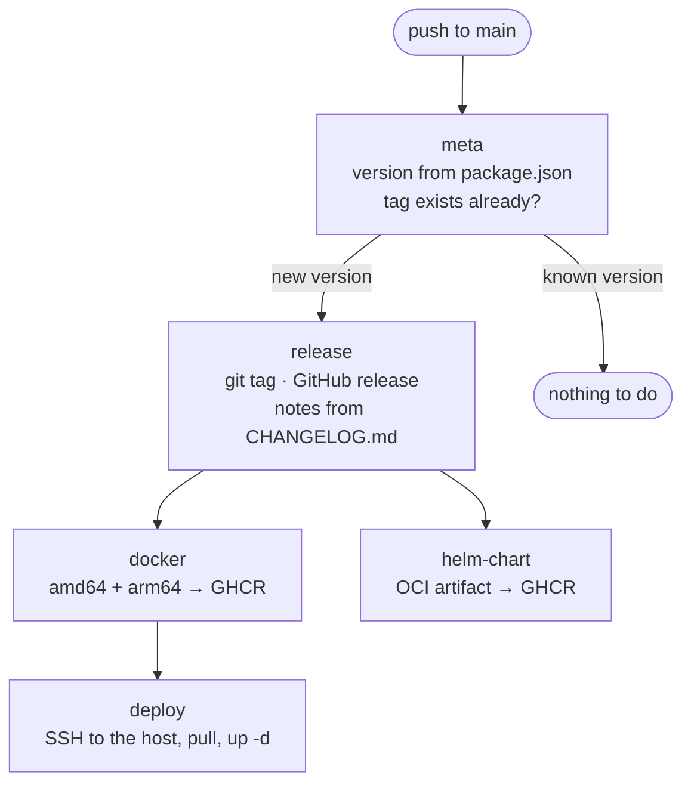
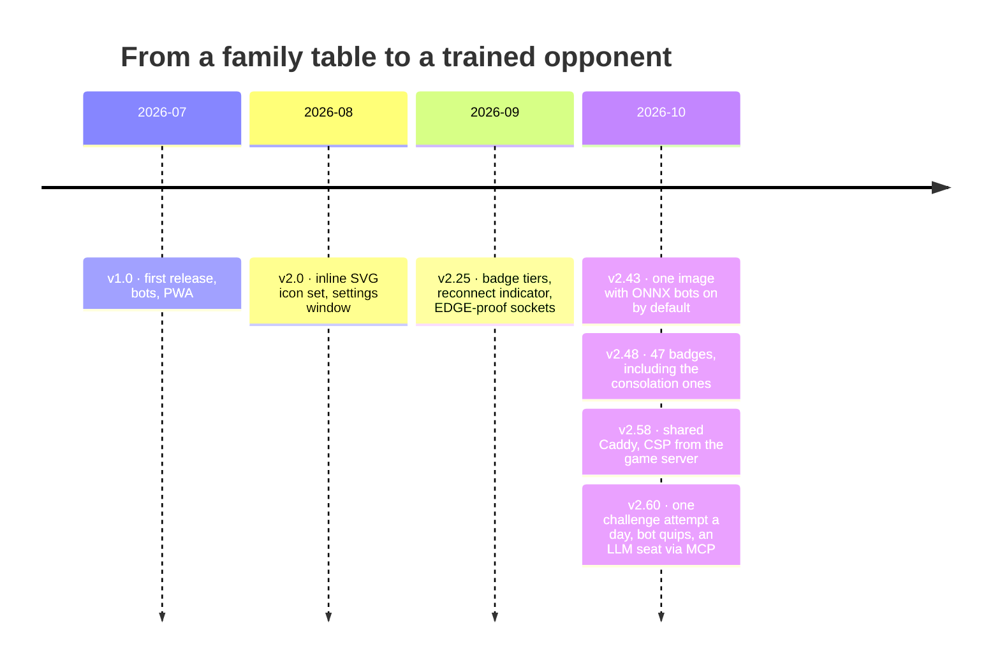

# Releases

Every merge to `main` with a version bump is tagged and released automatically.
Nothing is done by hand — not the tag, not the release notes, not the image.



**➡️ [All releases on GitHub](https://github.com/floriandeutsch89/pikdame-local/releases)**

One container image is published to the GitHub Container Registry on every
release, for **amd64 and arm64** (so a Raspberry Pi with a 64-bit OS works too):

```bash
docker pull ghcr.io/floriandeutsch89/pikdame-local:latest
```

It has the trained ONNX bots built in; `PIKDAME_ONNX=0` switches to the
heuristic bots — see {doc}`admin/onnx`. Up to v2.42.0 there was a second image,
`pikdame-local-onnx`; it is no longer published, switch back to `pikdame-local`.

## Milestones



## Versioning

[Semantic versioning](https://semver.org/), loosely:

- **Major** — a breaking change to how you run or configure it.
- **Minor** — new features, new gameplay, notable behaviour changes.
- **Patch** — bug fixes, performance, internals.

## Changelog

The complete, human-readable changelog is kept in the repository — in German,
since it is written for the people who actually play the game:

**➡️ [CHANGELOG.md](https://github.com/floriandeutsch89/pikdame-local/blob/main/CHANGELOG.md)**

## Upgrading

The stack auto-updates nightly via Watchtower. To pull a new version by hand:

```bash
cd docker
docker compose -f docker-compose.ghcr.yml pull
docker compose -f docker-compose.ghcr.yml up -d
```

Running games survive the restart — tables are snapshotted on shutdown and
restored on start, and clients reconnect on their own.
